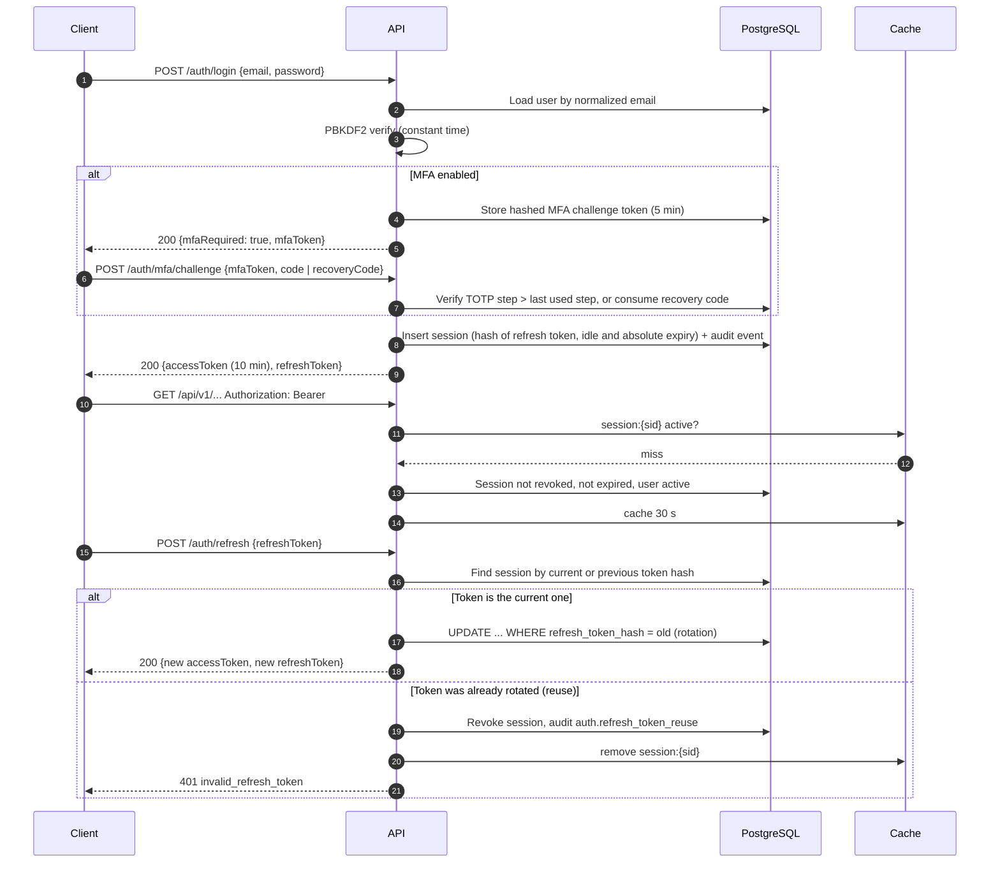
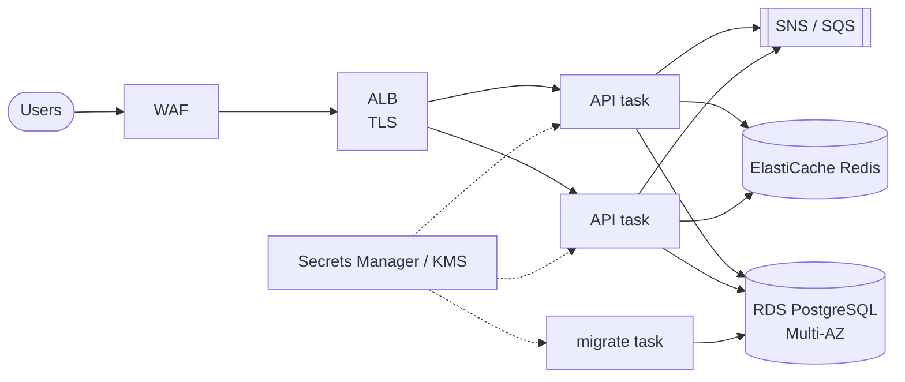

# Architecture

This document describes how the Python backend is structured, how tenant isolation and
authorization work, how appointment booking stays correct under concurrency, and why the main
design decisions were made. The architecture is the one agreed for every backend of the platform (the
.NET project is the reference implementation); section 11.1 lists the Python-specific design decisions.
Product scope is in [product-requirements.md](product-requirements.md),
the data model in [database-schema.md](database-schema.md) and the API in [api.md](api.md).

---

## 1. Overview

The backend is a **modular monolith**: one deployable FastAPI service (served by Uvicorn worker
processes) with clear module boundaries inside it, one PostgreSQL database, Redis as a shared cache and a message broker fed by a
transactional outbox. Background workers run inside the same process.

```mermaid
flowchart LR
    subgraph clients[Clients]
        web[React web app]
        other[Other API clients]
    end

    subgraph api[healthcare API process (one per Uvicorn worker)]
        mw[ASGI pipeline<br/>trace id, logging, security headers,<br/>CORS, auth, rate limits, tenant access]
        ctl[Routes and binder<br/>/api/v1]
        app[Application services<br/>auth, organizations, providers,<br/>patients, scheduling, audit]
        dom[Domain model<br/>rules, slot generator,<br/>permission matrix]
        infra[Infrastructure<br/>SQLAlchemy Core + asyncpg, security,<br/>cache, email, messaging]
        jobs[asyncio worker tasks<br/>outbox, reminders,<br/>maintenance, email]
    end

    pg[(PostgreSQL 17<br/>row-level security)]
    redis[(Redis<br/>session and access cache)]
    mq[[RabbitMQ topic exchange<br/>or SNS/SQS on AWS]]
    smtp[SMTP relay]
    otel[OTLP collector]

    web --> mw
    other --> mw
    mw --> ctl --> app --> dom
    app --> infra
    jobs --> infra
    infra --> pg
    infra --> redis
    infra --> mq
    infra --> smtp
    api -.traces and metrics.-> otel
```

### 1.1 Packages and dependency rules

| Package (`src/healthcare/…`) | Contains | May depend on |
|---|---|---|
| `domain` | Enumerations, the role-to-permission matrix, the appointment state machine and other rules (provider activation, credential review, consent revocation, lockout, weekly block overlap, NPI), calendar helpers (dates, `HH:mm` times, DST-aware local-to-UTC conversion) and the slot generator | The standard library only |
| `application` | Use cases per feature (`identity`, `organizations`, `providers`, `patients`, `scheduling`, `platform`), Pydantic request/response models with the request rules, the `Caller` context, `AccessResolver`, audit and outbox writers, paging and validation helpers, ports (`Database`/`Tx`, `PasswordHasher`, `TokenIssuer`, `FieldEncryptor`, `Cache`, `Mailer`, `ProviderLock`, `IdempotencyStore`) | `domain`, Pydantic |
| `infrastructure` | Configuration (pydantic-settings), the tenant-scoped transaction wrapper on SQLAlchemy asyncio + asyncpg, Core statements for the advisory lock, `ON CONFLICT` and `SKIP LOCKED`, Alembic migrations (reviewed SQL), PBKDF2 hasher, JWT issuer, AES-GCM encryptor, Redis/memory cache, email senders and worker, RabbitMQ/log publishers, background jobs, logging and tracing, the composition root (`bootstrap.py`) | `application`, `domain` |
| `api` | FastAPI application and lifespan, the outer ASGI middleware, the authentication pipeline, the three-stage body binder, query binding, problem documents, routes | All of the above |

Business rules live in the domain and application layers. Route handlers only bind the request, call
one use case and shape the HTTP response. Use cases run explicit, reviewed SQL through the `Tx` port
(named parameters, never string-built values); the application layer does not import SQLAlchemy, and
the three statements that need PostgreSQL-specific Core constructs live behind the `ProviderLock` and
`IdempotencyStore` ports in the infrastructure layer. Dependencies are wired by hand in
`infrastructure/bootstrap.py`; there is no service locator.

### 1.2 Module map

| Module | Domain | Application | API (`api/routes.py`) |
|---|---|---|---|
| Authentication and users | `rules.py` (lockout), `enums.py` | `identity/service.py` (accounts, sessions, MFA), `security.py` (tokens, TOTP) | `register_auth_routes` |
| Organizations and clinics | `authorization.py` | `organizations/service.py` (organizations, settings, members, invitations), `organizations/clinics.py` | `register_organization_routes`, `register_clinic_routes` |
| Providers | `rules.py` (credentials, NPI, weekly blocks) | `providers/profiles.py`, `providers/schedules.py` | `register_provider_routes` |
| Patients | — | `patients/service.py` (including minimum-necessary visibility) | `register_patient_routes` |
| Appointments | `rules.py` (state machine), `slots.py`, `calendar.py` | `scheduling/availability.py`, `appointments.py`, `waiting_list.py` | `register_appointment_routes` |
| Audit and platform | `enums.py` | `core/audit.py` (audit and outbox writers), `platform.py` | `register_appointment_routes` (audit trail) |
| Infrastructure | — | `core/ports.py` | `api/app.py`, `api/pipeline.py`, `api/context.py` |

Later modules (medical records, documents, messaging, notifications, billing, analytics) will be
added as new packages in each layer and new PostgreSQL schemas, following the same rules.

---

## 2. Request pipeline

Order of the request pipeline:

1. **Outer ASGI middleware** (`api/pipeline.py`): assigns the trace id (from the OpenTelemetry span,
   a valid `traceparent` header or a random value), opens the server span, normalizes the path for
   routing (literal segments are matched case-insensitively and a trailing slash is ignored, as the
   reference router does), answers CORS preflights (configured origins only), applies the security
   headers just before the response starts (`nosniff`, `X-Frame-Options: DENY`,
   `Referrer-Policy: no-referrer`, a restrictive CSP, `Cache-Control: no-store`, HSTS outside
   Development and Testing behind HTTPS, no `Server` header), turns an escaped exception into the
   generic 500 problem and writes one JSON log line per request (method, path without query string,
   status, duration).
2. **Routing** (FastAPI/Starlette routes, resolved with the reference's rules in `api/routing.py`): a
   template literal wins over an identifier segment, "method not allowed" is decided before the GUID
   constraint of identifier segments, `Allow` lists the methods in ordinal order, unknown routes are
   an empty 404 and undeclared methods (including `HEAD` and plain `OPTIONS`) an empty 405, both only
   after authentication.
3. **Authentication pipeline** (`api/context.py`): bearer token (RS256 only, issuer and audience
   validated, 30 s clock skew; a stale token sent to an anonymous endpoint is ignored), rate limiting
   (fixed one-minute windows per process: 600 requests per user or per address; 20 per address on
   sign-in and recovery endpoints; switchable off), session re-check, organization selection and
   access resolution (section 3), then the authentication requirement of every endpoint not declared
   anonymous.
4. **Handler**: the body is bound in the reference's three stages (unreadable body → missing
   required properties → the request's own rules; [hardest-challenge.md](hardest-challenge.md)), the
   use case runs, and `AppError`s become problem documents.

Bodies are limited to 1 MiB (413). Uvicorn's own access log and `Server` header are disabled.
Shutdown allows 30 s (`HostOptions__ShutdownTimeoutSeconds`) for in-flight requests; the lifespan
then cancels the worker tasks and closes the pool, the cache client and the broker connection.

---

## 3. Multi-tenancy and authorization

### 3.1 Selecting the organization

- Tenant-scoped endpoints read the organization from the **`X-Organization-Id`** header.
- Endpoints under `/api/v1/organizations/{organizationId}` take it from the route instead.
- Account endpoints (`/auth`, `/users`, `/invitations`, `/directory`) are not tenant-scoped.

The value selects a tenant; it grants nothing by itself. The backend resolves the caller's
relationship with that organization on every request.

### 3.2 Resolving access

`AccessResolver` builds a `TenantAccess` (roles, permissions, membership id, provider id, linked
patient ids) for the user and organization:

| Situation | Effective roles |
|---|---|
| Active membership | The membership's roles (`owner`, `clinic_admin`, `provider`, `receptionist`, `staff`) |
| User is linked to one or more patient records | adds the derived role `patient` |
| No membership and no patient link, organization allows self-scheduling | derived role `guest` |
| No relationship and self-scheduling disabled | access denied (`not_a_member`) |
| Organization suspended or closed | access denied (`organization_suspended`) |

`provider` holders whose user account is linked to a provider profile get that `ProviderId`, which
scopes their "own" permissions. Permissions are computed from roles on every request; only roles and
links are cached.

**Caching.** Session validity is cached for **30 s** (`session:{id}`) and access snapshots for
**60 s** (`access:{organization}:{user}`) in the distributed cache (Redis, or in-memory for a single
instance). Entries are removed immediately on sign-out, session revocation, password change or
reset, suspension, refresh-token reuse, membership changes, invitation acceptance, provider–user
linking, patient self-registration and organization suspension or reinstatement. A cache outage is a
cache miss, never a failure.

`Caller` is a per-request object holding the user, session, organization, `TenantAccess`, client
address, user agent and trace id. It is passed explicitly to every use case, which calls
`require(permission)`, `has(permission)`, `require_organization_id()` and `require_platform_admin()`
on it.

### 3.3 Permission matrix

The matrix is defined in `src/healthcare/domain/authorization.py` and is part of the
cross-implementation contract.

| Permission | owner | clinic_admin | provider | receptionist | staff | patient | guest |
|---|:-:|:-:|:-:|:-:|:-:|:-:|:-:|
| `organization.read` | ✔ | ✔ | ✔ | ✔ | ✔ | | |
| `organization.manage` | ✔ | | | | | | |
| `members.read` / `members.manage` | ✔ | ✔ | | | | | |
| `clinics.read` | ✔ | ✔ | ✔ | ✔ | ✔ | ✔ | ✔ |
| `clinics.manage` | ✔ | ✔ | | | | | |
| `providers.read` | ✔ | ✔ | ✔ | ✔ | ✔ | ✔ | ✔ |
| `providers.manage` | ✔ | ✔ | | | | | |
| `providers.manage_own` | | | ✔ | | | | |
| `credentials.verify` | ✔ | ✔ | | | | | |
| `schedules.read` | ✔ | ✔ | ✔ | ✔ | ✔ | | |
| `schedules.manage` | ✔ | ✔ | | | | | |
| `schedules.manage_own` | | | ✔ | | | | |
| `availability.read` | ✔ | ✔ | ✔ | ✔ | ✔ | ✔ | ✔ |
| `patients.read` | ✔ | ✔ | | ✔ | ✔ | | |
| `patients.read_assigned` | | | ✔ | | | | |
| `patients.write` | ✔ | ✔ | | ✔ | | | |
| `patients.self` | | | | | | ✔ | |
| `patients.self_register` | | | | | | | ✔ |
| `appointments.read` | ✔ | ✔ | | ✔ | ✔ | | |
| `appointments.read_own` | | | ✔ | | | | |
| `appointments.manage` | ✔ | ✔ | | ✔ | | | |
| `appointments.manage_own` | | | ✔ | | | | |
| `appointments.conduct` | ✔ | ✔ | ✔ | | | | |
| `appointments.self` | | | | | | ✔ | |
| `waiting_list.manage` | ✔ | ✔ | | ✔ | | | |
| `audit.read` | ✔ | ✔ | | | | | |

Additional rules enforced in services:

- Only an owner can grant, change or remove the owner role; the last active owner cannot be demoted
  or removed (`last_owner`).
- An invitation can be accepted only by a verified account with the invited email address.
- A provider profile can be linked only to an active member holding the `provider` role; a reviewer
  cannot verify credentials on their own profile.
- `platform_admin` is a platform role carried in the access token. It allows listing all
  organizations, suspending and reinstating organizations and user accounts, and reading an
  organization's profile. It grants **no** tenant permissions and therefore no access to patient
  data.

### 3.4 Minimum-necessary visibility

Lists and lookups are narrowed to what the caller needs. Records outside the caller's scope return
**404**, so their existence is not revealed.

| Data | Staff with `*.read` | Provider | Patient | Guest |
|---|---|---|---|---|
| Patients (`patients.service.visible_condition`) | All patients of the organization | Patients with an active care relationship **or** any appointment with them | Linked records only | None |
| Appointments (`scheduling.appointments.visible_condition`) | All | Their own calendar | Their own appointments | None |
| Waiting list | All (`waiting_list.manage` or `appointments.read`) | None | Own entries | None |
| Providers | All statuses | All statuses | Active only | Active only |

Patients may change their contact details and preferences but not their name, date of birth or
administrative gender (`identity_fields_locked`). Patients and guests book with the patient rules
(minimum notice, cancellation window); staff and providers acting on their own calendar book with
staff rules.

### 3.5 Defence in depth

Tenant isolation is enforced in four independent ways:

1. **An explicit tenant predicate in every query** (`organization_id = :selected organization`),
   written into each reviewed SQL statement and covered by the tenant isolation tests.
2. **PostgreSQL row-level security**, enabled and **forced** on every tenant table. The transaction
   wrapper (`SqlDatabase.transaction`) is the only path to the database: its first statement sets
   `app.current_organization_id`, `app.current_user_id` and `app.access_scope` with
   `set_config(..., true)`, i.e. transaction-local, so the values vanish at commit or rollback and a
   pooled connection never carries another request's scope.
3. **Composite tenant foreign keys**: child rows reference `(organization_id, id)` of their parent,
   so a row cannot point at another organization's patient, provider or location even if the
   application tried.
4. **A restricted database role**: the API connects as `healthcare_app`, which owns nothing, has no
   `BYPASSRLS`, cannot change the schema, cannot update or delete audit events or appointment
   history, and cannot delete patients, consents or appointments.

Code paths that legitimately span organizations — background jobs, the provider directory and
platform administration — open their transaction with `caller.system_scope()` (or `SYSTEM_SCOPE`),
which is visible in code review and limited to a handful of queries. A transaction can switch scope
with `tx.set_scope(...)`.

```mermaid
flowchart TD
    req[Request with bearer token<br/>and X-Organization-Id] --> jwt{Token valid?<br/>signature, issuer,<br/>audience, expiry}
    jwt -- no --> r401[401 unauthorized]
    jwt -- yes --> sess{Session active?<br/>cache 30 s, then DB}
    sess -- no --> r401b[401 session_expired]
    sess -- yes --> acc[Resolve access<br/>membership, patient links,<br/>org status, self-scheduling<br/>cache 60 s]
    acc --> perm{Service checks<br/>permission}
    perm -- missing --> r403[403 forbidden / not_a_member /<br/>organization_suspended]
    perm -- granted --> scope[Service narrows scope<br/>provider: assigned patients<br/>patient: own records]
    scope --> ef[SQL tenant predicate<br/>organization_id = selected]
    ef --> conn[Transaction begun:<br/>set_config(..., true) app.current_organization_id,<br/>app.current_user_id, app.access_scope]
    conn --> rls[(PostgreSQL RLS policies<br/>FORCE ROW LEVEL SECURITY<br/>role healthcare_app)]
    rls --> fk[Composite FKs keep<br/>references inside the tenant]
```

---

## 4. Authentication

- **Credentials** are managed locally in Release 1. Passwords are hashed with PBKDF2-HMAC-SHA256,
  600,000 iterations, 16-byte salt, stored as `pbkdf2-sha256$iterations$salt$hash` so every backend
  can verify the same hashes and the cost can be raised (hashes are upgraded at the next sign-in).
  Unknown accounts take the same hashing time as known ones.
- **Access tokens** are RS256 JWTs valid for 10 minutes, carrying `sub`, `sid` (session id), `jti`
  and, for platform staff, `platform_role`. Organization roles are **not** in the token; they are
  resolved per request so changes apply immediately. The public key is published at
  `/.well-known/jwks.json`.
- **Refresh tokens** are 256-bit random values stored only as SHA-256 hashes in `identity.sessions`.
  Each refresh rotates the token with a conditional update, so concurrent refreshes cannot both
  succeed. Presenting the previous token again (after a 10 s grace window) revokes the session.
- **Sessions** have a 60-minute idle timeout and a 12-hour absolute lifetime.
- **MFA** uses TOTP (RFC 6238, 6 digits, 30 s, ±1 step) with the secret encrypted by AES-256-GCM, a
  replay guard on the last used time step, and 10 single-use recovery codes stored as hashes.
- **Lockout** after 5 failed attempts for 15 minutes; failed MFA codes count as failures.
- **Single-use tokens** (email verification 24 h, password reset 60 min, MFA challenge 5 min,
  invitations 7 days) are stored hashed; issuing a new one invalidates older unused ones.
- Registration, resend-verification and forgotten-password responses are identical whether or not
  the account exists.



External OpenID Connect federation (Release 5) will add an `identity.user_identities` table linking
a user to an external subject. Access-token issuance and per-request authorization stay unchanged.

---

## 5. Appointment booking

### 5.1 Availability

`SlotGenerator` (pure domain code) expands weekly blocks into slots in each location's IANA time
zone, skips clinic holidays, adds extra hours, and removes slots that overlap time off or existing
appointments. Local times that do not exist on a spring-forward day are skipped; the repeated hour on
a fall-back day produces no overlapping slots. Slot length comes from the schedule block, then the
provider's default, then the organization default. Patients additionally see only slots after the
minimum booking notice; everyone is limited to the booking horizon. Requests may span at most 31
days.

### 5.2 Booking

A booking is valid only if it starts exactly at an open slot. Correctness under retries and races
relies on three mechanisms in one transaction:

1. **Idempotency key** (required header). The key is inserted into `platform.idempotency_records`
   with `ON CONFLICT DO NOTHING` inside the booking transaction. A concurrent request with the same
   key blocks on the unique index until the first commits, then replays the stored response. A key
   reused with a different body is rejected.
2. **Per-provider advisory lock** (`pg_advisory_xact_lock(hashtextextended(provider_id))`, 5 s lock
   timeout). Requests for the same provider are serialized, so slot validation and insert see a
   consistent calendar. Bookings for different providers do not wait for each other.
3. **Exclusion constraint** `ex_appointments_provider_no_overlap` — `EXCLUDE USING gist (provider_id
   WITH =, tstzrange(starts_at, ends_at, '[)') WITH &&) WHERE status NOT IN ('cancelled', 'no_show')`.
   This is the final guarantee: even code that bypassed the application could not store overlapping
   appointments.

Any conflict is returned as **409** (`slot_unavailable`, or `schedule_busy` if the lock times out).

```mermaid
sequenceDiagram
    autonumber
    participant C as Client
    participant A as AppointmentService (scheduling/appointments.py)
    participant DB as PostgreSQL

    C->>A: POST /appointments + Idempotency-Key
    A->>A: Resolve actor (staff / provider own calendar / patient self)
    A->>DB: BEGIN
    A->>DB: INSERT idempotency_records ON CONFLICT DO NOTHING
    alt Key already used
        DB-->>A: existing row (waits if the first request is still running)
        A->>DB: ROLLBACK
        A-->>C: 201 stored response, Idempotent-Replayed: true<br/>(422 if the body differs)
    else New key
        A->>DB: SET LOCAL lock_timeout = 5s; pg_advisory_xact_lock(provider)
        A->>DB: Load schedules, exceptions, holidays, appointments
        A->>A: SlotGenerator: is startsAt an open slot?
        alt Not open
            A->>DB: ROLLBACK
            A-->>C: 409 slot_unavailable
        else Open
            A->>DB: INSERT appointment (exclusion constraint checked)
            A->>DB: INSERT status history, reminders, audit event, outbox event
            A->>DB: UPDATE idempotency_records SET response_body
            A->>DB: COMMIT
            A-->>C: 201 appointment, Idempotent-Replayed: false
        end
    end
```

### 5.3 Life cycle

```text
pending ──► confirmed ──► checked_in ──► in_progress ──► completed
   │            │  │            │
   └► cancelled ◄┘  └► no_show   └► cancelled
```

Transitions are enforced by the domain (`invalid_status_transition`, 409). Every change writes
`scheduling.appointment_status_history`. A no-show can be recorded only after the start time.
Patients cannot cancel or reschedule inside the organization's cancellation window. Rescheduling
uses the same lock and slot check, keeps the appointment id and records the previous times.
Cancellation, no-show and rescheduling cancel pending reminders; rescheduling plans new ones.
Updates to appointment details use optimistic concurrency (`version`).

---

## 6. Asynchronous processing

### 6.1 Transactional outbox

Services add `platform.outbox_events` rows in the same transaction as the change (for example
`appointment.booked`, `appointment.cancelled`, `appointment.rescheduled`, `patient.registered`,
`organization.created`, `appointment.reminder_due`). Payloads contain identifiers, times and statuses
only — never names, reasons or contact details.

`OutboxDispatchJob` claims due rows with `FOR UPDATE SKIP LOCKED` (a SQLAlchemy Core
`select(...).with_for_update(skip_locked=True)`) in batches of 50, publishes each through the
`Publisher` and marks it processed. Failures are retried with exponential back-off
(5 s × 2ⁿ, capped at one hour); only the exception type is stored. Delivery is **at least once**:
the event id is sent as the message id so consumers can de-duplicate. Publishers:

- `RabbitMqPublisher` (aio-pika) — durable topic exchange `healthcare.events`, routing key = event
  type, persistent messages, publisher confirms, robust connection that is re-opened after a failure.
- `LogPublisher` — logs event type and id only; the default when no broker is configured.

### 6.2 Reminders and maintenance

- `ReminderDispatchJob` claims due reminders (`SKIP LOCKED`), turns each into an
  `appointment.reminder_due` outbox event, and cancels reminders whose appointment is no longer
  pending or confirmed or has started.
- `MaintenanceJob` (hourly) deletes expired idempotency records, sessions and single-use tokens
  30 days after expiry, published outbox events after 14 days, and expires stale invitations and
  waiting list entries.

All jobs run as asyncio tasks started by the lifespan (`run_job`): each iteration runs in system
scope, failures are logged and retried after five seconds, and cancellation on shutdown stops them
cleanly. Every worker process of every instance runs the jobs unless `Workers__Enabled` is false;
`SKIP LOCKED` makes this safe.

### 6.3 Email

Account emails (verification, password reset, invitation, "account already exists") are composed by
`QueueMailer`, placed on a bounded in-memory `asyncio.Queue` (one per worker process) and sent by
`EmailWorker` (aiosmtplib, a pickup folder, or nowhere) with three attempts. The queue is **not durable**: a message lost in a crash is recovered by the user asking for
it again. This is an accepted trade-off for account emails; patient notifications in Release 2 will
use the outbox with tracked delivery. Emails contain no health information.

---

## 7. Caching

| Entry | Key | TTL | Invalidated by |
|---|---|---|---|
| Session validity | `session:{sessionId}` | 30 s | Sign-out, revocation, password change/reset, suspension, refresh reuse |
| Organization access snapshot (roles, membership, provider id, patient ids, denial reason) | `access:{organizationId}:{userId}` | 60 s | Membership change or removal, invitation acceptance, provider linking, self-registration, organization suspension/reinstatement |

Redis keys are prefixed `healthcare:`. No PHI is cached; the cache holds identifiers and role names.
Without a Redis connection string an in-memory cache is used, which is correct only for a single
instance.

---

## 8. Observability

- **Logs:** standard-library logging with a JSON formatter to stdout (`@t`, `@l`, `@m`, trace id and
  structured fields). Request logs contain the path without the query string. Application logs use
  identifiers, counts, codes and exception types; recipients, names and request bodies are never
  logged. SQLAlchemy statement logging is off.
- **Traces:** an OpenTelemetry server span per request (health checks excluded) with W3C trace
  context propagation; export over OTLP/HTTP is enabled by `OTEL_EXPORTER_OTLP_ENDPOINT`. The trace id
  is the `traceId` of problem documents.
- **Health:** `/health/live` (process only) and `/health/ready` (PostgreSQL; cache reported as
  degraded, not unhealthy, when Redis is down).
- **Audit:** `platform.audit_events`, written in the same transaction as the change (section 3 of
  [security-and-compliance.md](security-and-compliance.md)).

---

## 9. Error model

Errors are RFC 9457 problem details (`application/problem+json`) with `type`
(`urn:healthcare:problem:{code}`), `title`, `status`, a stable machine-readable `code`, a safe
`detail`, the `traceId`, and `errors` (field → messages) for validation failures. Mapping:

| Error | Status |
|---|---|
| `AppError` of kind `BAD_REQUEST` (`validation_failed` and other codes), unreadable body | 400 |
| `AppError` of kind `UNAUTHORIZED`, invalid or missing token | 401 |
| `AppError` of kind `FORBIDDEN` | 403 |
| `AppError` of kind `NOT_FOUND` | 404 |
| `AppError` of kind `CONFLICT`, `DomainError` of kind `CONFLICT`, exclusion/unique violations, optimistic concurrency | 409 |
| `AppError` of kind `RULE`, `DomainError` of kind `RULE` | 422 |
| Rate limit | 429 |
| Anything else | 500 `internal_error` (logged with the stack trace; never returned) |

PostgreSQL errors are translated by `persistence.database.translate` so constraint names and SQL never
reach clients. The full code list is in [api.md](api.md#error-codes).

---

## 10. Deployment overview

One container image serves the API and, started with `migrate`, applies migrations as the schema
owner. The AWS reference design runs the API on ECS Fargate behind an ALB and WAF, with RDS
PostgreSQL (Multi-AZ), ElastiCache Redis, SNS/SQS, Secrets Manager and KMS. Details, environments,
CI/CD and recovery procedures are in [deployment.md](deployment.md).



---

## 11. Key decisions

| # | Decision | Reasoning | Consequences |
|---|---|---|---|
| 1 | **Modular monolith** rather than microservices | One team, one release cadence, strongly related data (appointments need patients, providers and locations in one transaction). Module folders and schemas keep boundaries clear. | Simple deployment and transactions. Modules can be extracted later along the outbox events if scale or ownership demands it. |
| 2 | **Local credentials now, OIDC federation later** | The product needs patient self-registration, MFA and session control on day one without depending on a customer's identity provider. | The platform issues its own tokens. Federation adds an identity link table; authorization is unchanged. Password storage is a security responsibility of the platform. |
| 3 | **Row-level security in addition to query filters** | A single missing `WHERE organization_id` must not expose another practice's patients. RLS is enforced by the database for every query, including raw SQL. | Each connection must carry the tenant settings; a connection proxy must pin sessions or the settings must move to transaction scope. Cross-tenant paths must opt into system scope explicitly. |
| 4 | **PBKDF2-HMAC-SHA256, 600,000 iterations** | Available natively and in constant time in every target language, which lets the other backends verify the same hashes; the iteration count follows current OWASP guidance for this algorithm. | Sign-in costs CPU by design (see capacity model). The encoded format allows raising the cost or switching to Argon2id later with rehash on sign-in. |
| 5 | **Advisory lock plus exclusion constraint** for booking | The constraint guarantees no overlap regardless of code path; the lock turns races into fast, orderly 409s instead of constraint-violation retries and keeps slot validation consistent. | Bookings for one provider are serialized (fine at observed booking rates); different providers do not contend. |
| 6 | **Idempotency record inside the booking transaction** | A retry must not create a second appointment, even if the first response was lost or the retry arrives while the first is still running. | Keys are scoped by organization, user and operation; responses are stored for 48 h and contain PHI, so the table is tenant-isolated and purged. |
| 7 | **Enums as snake_case strings** in JSON and the database | Readable data, stable across languages and safe to extend; check constraints document allowed values. | Slightly larger columns than integers; no ordinal coupling. |
| 8 | **UUIDv7 identifiers** generated by the application | Globally unique, non-guessable enough to avoid enumeration, and time-ordered so B-tree inserts stay local. Ids are known before saving, which simplifies outbox and audit writes. | 16-byte keys; ordering reveals approximate creation time (not sensitive here). |
| 9 | **RabbitMQ locally, SNS + SQS on AWS** behind the `Publisher` protocol | RabbitMQ runs in Compose and supports topic routing; SNS/SQS removes broker operations in AWS. Kafka's replay and throughput are not needed. | The SNS publisher is not written yet; Amazon MQ for RabbitMQ is the no-code alternative. |
| 10 | **Organization roles resolved per request, not embedded in tokens** | Role removal, suspension and new memberships must take effect immediately, and a user can belong to several organizations. | One cached lookup per request; at most 60 s staleness only where an invalidation path is missing. |
| 11 | **One OpenAPI contract for every backend** | The reference generates it from its implementation; this backend serves the committed copy (`docs/openapi.yaml`, byte-identical, also packaged as `healthcare/api/openapi.yaml`) and contract tests check that every operation is implemented and that real responses validate against its schemas. | Intentional API changes start in the reference and are copied here. |

### 11.1 Python-specific design decisions

- **FastAPI for the application, not for request validation.** FastAPI/Starlette provide the ASGI
  application, routing, the lifespan and the test-friendly structure; FastAPI's request validation
  and generated OpenAPI are not used. Its default 422 documents and Pydantic's lax coercion (`"1"` →
  1, `1.0` → 1, `null` → default) contradict the reference's binding, so handlers take the raw
  `Request` and call the three-stage binder (`api/binding.py`). Request models are still Pydantic
  models: the binder reads their field metadata and fills them with `model_construct`, and their
  `check()` method holds the request's own rules. The full reasoning is in
  [hardest-challenge.md](hardest-challenge.md).
- **Pydantic v2 for responses and configuration.** Response models use camelCase aliases and
  `exclude_none` (the reference omits nulls); annotated serializers write instants as UTC with `Z`
  (or `+00:00` for values stored for other backends) and times as `HH:mm`. The resulting data is
  written by `jsonref.reference_json`, which reproduces the reference's escaping (`"&'+<>` and
  non-ASCII as upper-case `\uXXXX`). Settings are a pydantic-settings model fed by a source that maps
  the reference's `Section__Key` variables case-insensitively.
- **SQLAlchemy 2 asyncio over asyncpg, Core only.** No ORM: use cases run reviewed SQL through
  `text()` statements (cached per SQL string; asyncpg prepares and caches them per connection). Core
  constructs are used where PostgreSQL features matter: `pg_advisory_xact_lock(hashtextextended(...))`,
  `INSERT ... ON CONFLICT DO NOTHING` for idempotency and `SELECT ... FOR UPDATE SKIP LOCKED` in the
  jobs. Optimistic concurrency is an explicit `WHERE version = :expected` with a row count check.
- **One transaction wrapper as the only database path.** `SqlDatabase.transaction(scope)` is an async
  context manager: BEGIN, the three `set_config(..., true)` calls, the body, then COMMIT or ROLLBACK;
  constraint violations are translated to `AppError`s on the way out. The scope can be switched inside
  a transaction (`tx.set_scope`).
- **Context passed explicitly.** The `Caller` is an argument of every use case (no ambient request
  state in services); a `contextvars.ContextVar` carries only the trace id for log records.
- **CPU work off the event loop.** PBKDF2 (600,000 iterations, `hashlib.pbkdf2_hmac`, which releases
  the GIL inside OpenSSL) runs on worker threads through `anyio.to_thread.run_sync`, so sign-ins do not
  stall other requests of the same process. RSA signing and verification of tokens take well under a
  millisecond and run inline.
- **Processes for parallelism.** One process executes Python on one core at a time, so production runs
  several Uvicorn worker processes (`HEALTHCARE_WORKERS`). Each worker has its own pool
  (`Maximum Pool Size` per worker), its own rate limiter windows and its own email queue; the shared
  state (sessions, access snapshots) lives in Redis, and the background jobs coordinate through the
  database with `SKIP LOCKED`.
- **Time zones with `zoneinfo` and the `tzdata` package**, so the IANA database is identical on Windows
  and Linux. Local-to-UTC conversion tries both folds and keeps the later valid instant (standard time
  for a repeated hour) and rejects times skipped by DST.
- **UUIDv7 from the standard library** (`uuid.uuid7`, Python 3.14).
- **Alembic with reviewed SQL.** Each revision executes one SQL file through asyncpg's simple query
  protocol inside the migration transaction; V2 is the reference's security script, byte-identical.
  A database already migrated by another backend is detected and stamped (baselined) instead of being
  migrated again.
- **Quality gates:** a docstring on every function, type hints throughout, `ruff` and
  `mypy --strict` clean for `src` and `tests`, pytest with pytest-asyncio for unit and integration
  tests.
