# Database Schema

PostgreSQL 17 (16 or later is expected to work). This document is the shared database design of the
platform; every backend produces the same tables, columns, constraints and policies.

**Migration tool of the Python backend: Alembic**, with migrations kept as reviewed SQL in
`src/healthcare/infrastructure/persistence/migrations/` (each revision runs one SQL file through
asyncpg's simple query protocol inside the migration transaction):

| Revision | SQL file (`migrations/sql/`) | Contents |
|---|---|---|
| `0001` | `0001_initial_schema_up.sql` (down: `0001_initial_schema_down.sql`) | Schemas, 30 tables, primary and foreign keys, unique and secondary indexes, check constraints, reviewed against `pg_dump --schema-only` of a database migrated by the reference implementation |
| `0002` | `0002_security_up.sql` (down: `0002_security_down.sql`) | The reference's security script, **byte-identical**: session-context functions, the appointment exclusion constraint, case-insensitive search indexes, row-level security policies and the privileges of `healthcare_app` |

The Alembic history table is `platform.alembic_version` (the reference uses
`platform.__ef_migrations_history`); the history table is the only object that differs between
backends. A `pg_dump --schema-only` of a database migrated by this backend and one migrated by the
reference are identical apart from their history tables (checked during development: 2,561 lines each,
no other difference). When the migration command finds the schema already created by another backend
and no Alembic history, it records the existing revision (`0001` or `0002`) without running it again
(baseline) and continues from there.

---

## 1. Conventions

| Topic | Rule |
|---|---|
| Names | `snake_case` tables and columns; tables are plural |
| Primary keys | `id uuid`, generated by the application as UUID version 7 (time-ordered). Exceptions: `organization_settings` (PK = `organization_id`), `provider_locations` (composite PK) |
| Tenant column | Every tenant-owned table has `organization_id uuid NOT NULL` |
| Tenant-safe references | Tenant-owned parents expose an alternate key `(organization_id, id)`; children reference it with composite foreign keys, so a child cannot point at another organization's row |
| Timestamps | `timestamp with time zone`, always written in UTC |
| Local times and dates | `time without time zone` (schedule blocks, interpreted in the location's IANA time zone) and `date` |
| Time zones | IANA identifiers (`America/Chicago`) in `organizations.time_zone` and `clinic_locations.time_zone` |
| Enumerations | `character varying(40)` holding snake_case values, each guarded by a check constraint `ck_{table}_{column}` listing the allowed values |
| Arrays | `text[]` for roles, `integer[]` for reminder offsets |
| JSON | `jsonb` for audit metadata, outbox payloads and stored idempotent responses |
| Optimistic concurrency | Mutable aggregates have `version integer NOT NULL`, set to 1 on insert and incremented on every update; updates include `WHERE version = @expected` and clients send the version they read (`409 concurrency_conflict` on mismatch) |
| Audit columns | `created_at` / `updated_at` maintained by the application on save |
| Deletion | Foreign keys are `RESTRICT` (or `NO ACTION` for optional references) except provider child collections, which cascade from `providers`. The application role cannot delete patients, consents or appointments |

### 1.1 Schemas

| Schema | Purpose | Data class |
|---|---|---|
| `identity` | Accounts, sessions, single-use tokens, MFA | Confidential; credentials hashed or encrypted |
| `organization` | Tenants, settings, memberships, invitations, clinics, locations, holidays | Confidential business data |
| `provider` | Provider profiles, credentials, specialties, locations, schedules, exceptions | Confidential business data |
| `patient` | Patient records, account links, emergency contacts, care relationships, consents | **PHI** |
| `scheduling` | Appointments, status history, reminders, waiting list | **PHI** |
| `platform` | Audit trail, idempotency records, outbox, migration history (`alembic_version` here; `__ef_migrations_history` for the reference) | Operational metadata |
| `app` | Session-context functions used by row-level security | — |

---

## 2. Entity-relationship diagram

```mermaid
erDiagram
    users ||--o{ sessions : has
    users ||--o{ user_tokens : has
    users ||--o{ mfa_factors : has
    users ||--o{ mfa_recovery_codes : has
    users ||--o{ organization_memberships : "member of"
    users ||--o{ patient_account_links : "portal access"
    users |o--o{ providers : "signs in as"
    users ||--o{ staff_invitations : "invited by"

    organizations ||--|| organization_settings : configures
    organizations ||--o{ organization_memberships : has
    organizations ||--o{ staff_invitations : sends
    organizations ||--o{ clinics : operates
    organizations ||--o{ clinic_holidays : closes
    organizations ||--o{ providers : employs
    organizations ||--o{ patients : registers
    organizations ||--o{ idempotency_records : scopes

    clinics ||--o{ clinic_locations : has
    clinic_locations |o--o{ clinic_holidays : closes
    clinic_locations ||--o{ provider_locations : hosts
    clinic_locations ||--o{ provider_schedules : "worked at"
    clinic_locations |o--o{ schedule_exceptions : "extra hours at"
    clinic_locations ||--o{ appointments : "held at"
    clinic_locations |o--o{ waiting_list_entries : preferred

    providers ||--o{ provider_specialties : has
    providers ||--o{ provider_credentials : holds
    providers ||--o{ provider_locations : "practices at"
    providers ||--o{ provider_schedules : works
    providers ||--o{ schedule_exceptions : has
    providers ||--o{ patient_provider_relationships : cares
    providers ||--o{ appointments : sees
    providers |o--o{ waiting_list_entries : preferred

    patients ||--o{ patient_account_links : "linked to"
    patients ||--o{ emergency_contacts : has
    patients ||--o{ patient_provider_relationships : "cared by"
    patients ||--o{ patient_consents : gives
    patients ||--o{ appointments : books
    patients ||--o{ waiting_list_entries : waits

    appointments ||--o{ appointment_status_history : records
    appointments ||--o{ appointment_reminders : schedules

    audit_events }o..o| organizations : "about (no FK)"
    outbox_events }o..o| organizations : "about (no FK)"
```

`audit_events` and `outbox_events` intentionally have no foreign keys: they are append-only records
that must survive changes to the rows they describe.

---

## 3. Tables

Legend: **R** = required (`NOT NULL`), **N** = nullable. Lengths are `character varying(n)` unless
stated. "Tenant" states how the row is tied to an organization.

### 3.1 `identity` schema

#### `identity.users`

Global account; not tenant-owned. Access to tenant data comes from memberships and patient links.

| Column | Type | R/N | Notes |
|---|---|:-:|---|
| `id` | uuid | R | PK |
| `email` | 254 | R | As entered |
| `email_normalized` | 254 | R | Trimmed lower-case; **unique** `ux_users_email_normalized` |
| `password_hash` | 300 | N | `pbkdf2-sha256$iterations$salt$hash`; null for future federated-only accounts |
| `first_name`, `last_name` | 100 | R | |
| `phone` | 30 | N | |
| `status` | enum | R | `pending_verification`, `active`, `suspended`, `deactivated` |
| `email_verified_at` | timestamptz | N | |
| `platform_role` | 40 | N | Check `ck_users_platform_role`: null or `platform_admin` |
| `mfa_enabled` | boolean | R | |
| `failed_login_count` | integer | R | Reset on success or lockout |
| `lockout_until` | timestamptz | N | |
| `last_login_at` | timestamptz | N | |
| `created_at`, `updated_at` | timestamptz | R | |

Retention: life of the account; deactivation rather than deletion.

#### `identity.sessions`

| Column | Type | R/N | Notes |
|---|---|:-:|---|
| `id` | uuid | R | PK; carried in the access token as `sid` |
| `user_id` | uuid | R | FK → `users.id` |
| `refresh_token_hash` | 64 | R | SHA-256 hex; **unique** `ux_sessions_refresh_token_hash` |
| `previous_refresh_token_hash` | 64 | N | For reuse detection; index `ix_sessions_previous_refresh_token_hash` |
| `rotated_at`, `last_used_at` | timestamptz | N / R | |
| `created_at`, `idle_expires_at`, `expires_at` | timestamptz | R | Idle (60 min sliding) and absolute (12 h) expiry |
| `revoked_at` | timestamptz | N | |
| `revoked_reason` | 50 | N | `logout`, `password_reset`, `password_changed`, `account_suspended`, `refresh_token_reuse`, `revoked_by_user` |
| `mfa_verified` | boolean | R | |
| `ip_address` | 45 | N | |
| `user_agent` | 300 | N | |

Indexes: `ix_sessions_user_revoked (user_id, revoked_at)`, `ix_sessions_expires_at`. Retention:
deleted 30 days after `expires_at`.

#### `identity.user_tokens`

Single-use tokens for email verification, password reset and MFA challenges.

| Column | Type | R/N | Notes |
|---|---|:-:|---|
| `id` | uuid | R | PK |
| `user_id` | uuid | R | FK → `users.id` |
| `purpose` | enum | R | `email_verification`, `password_reset`, `mfa_challenge` |
| `token_hash` | 64 | R | **unique** `ux_user_tokens_token_hash` |
| `expires_at`, `created_at` | timestamptz | R | |
| `consumed_at` | timestamptz | N | |

Indexes: `ix_user_tokens_user_purpose`, `ix_user_tokens_expires_at`. Retention: 30 days after expiry.

#### `identity.mfa_factors`

| Column | Type | R/N | Notes |
|---|---|:-:|---|
| `id` | uuid | R | PK |
| `user_id` | uuid | R | FK → `users.id`; index `ix_mfa_factors_user` |
| `type` | 20 | R | `totp` |
| `secret_encrypted` | 500 | R | AES-256-GCM, format `v1.nonce.ciphertext.tag` |
| `status` | enum | R | `pending`, `active` |
| `created_at` | timestamptz | R | |
| `confirmed_at` | timestamptz | N | |
| `last_used_time_step` | bigint | N | Replay protection |

#### `identity.mfa_recovery_codes`

| Column | Type | R/N | Notes |
|---|---|:-:|---|
| `id` | uuid | R | PK |
| `user_id` | uuid | R | FK → `users.id` |
| `code_hash` | 64 | R | **unique** with user: `ux_mfa_recovery_codes_user_code` |
| `used_at` | timestamptz | N | |
| `created_at` | timestamptz | R | |

### 3.2 `organization` schema

#### `organization.organizations`

The tenant. Row-level security uses `id` as the tenant key.

| Column | Type | R/N | Notes |
|---|---|:-:|---|
| `id` | uuid | R | PK |
| `name` | 200 | R | |
| `slug` | 80 | R | **unique** `ux_organizations_slug` |
| `type` | enum | R | `independent_practice`, `clinic`, `multi_location_group` |
| `status` | enum | R | `active`, `suspended`, `closed` |
| `contact_email` | 254 | N | |
| `phone` | 30 | N | |
| `time_zone` | 64 | R | IANA |
| `created_at`, `updated_at` | timestamptz | R | |
| `version` | integer | R | Optimistic concurrency |

#### `organization.organization_settings`

One row per organization. PK and FK `organization_id` → `organizations.id`.

| Column | Type | R/N | Notes |
|---|---|:-:|---|
| `organization_id` | uuid | R | PK, FK |
| `default_appointment_duration_minutes` | integer | R | Check 5–480; default 30 |
| `minimum_booking_notice_minutes` | integer | R | Default 60 (patient bookings) |
| `booking_horizon_days` | integer | R | Check 1–365; default 90 |
| `patient_cancellation_window_hours` | integer | R | Default 24 |
| `reminder_offsets_minutes` | integer[] | R | Default `{1440,120}` |
| `allow_patient_self_scheduling` | boolean | R | Default true |
| `auto_confirm_patient_bookings` | boolean | R | Default false |
| `updated_at` | timestamptz | R | |

#### `organization.organization_memberships`

| Column | Type | R/N | Notes |
|---|---|:-:|---|
| `id` | uuid | R | PK |
| `organization_id` | uuid | R | FK → `organizations.id` |
| `user_id` | uuid | R | FK → `users.id`; index `ix_memberships_user` |
| `roles` | text[] | R | Check `ck_organization_memberships_roles`: subset of `owner, clinic_admin, provider, receptionist, staff`, at least one |
| `status` | enum | R | `active`, `suspended`, `removed` |
| `created_at`, `updated_at` | timestamptz | R | |

Unique `ux_memberships_organization_user (organization_id, user_id)`. Removal sets `status =
'removed'`; rows are kept for history.

#### `organization.staff_invitations`

| Column | Type | R/N | Notes |
|---|---|:-:|---|
| `id` | uuid | R | PK |
| `organization_id` | uuid | R | FK → `organizations.id` |
| `email`, `email_normalized` | 254 | R | Index `ix_staff_invitations_organization_email` |
| `roles` | text[] | R | |
| `token_hash` | 64 | R | **unique** `ux_staff_invitations_token_hash` |
| `status` | enum | R | `pending`, `accepted`, `revoked`, `expired` |
| `invited_by_user_id` | uuid | R | FK → `users.id` |
| `expires_at`, `created_at` | timestamptz | R | 7-day lifetime |
| `accepted_at` | timestamptz | N | |
| `accepted_by_user_id` | uuid | N | |

#### `organization.clinics`

| Column | Type | R/N | Notes |
|---|---|:-:|---|
| `id` | uuid | R | PK; alternate key `(organization_id, id)` |
| `organization_id` | uuid | R | FK → `organizations.id` |
| `name` | 200 | R | Index `ix_clinics_organization_name` |
| `description` | 2000 | N | |
| `phone` | 30 | N | |
| `email` | 254 | N | |
| `status` | enum | R | `active`, `inactive` |
| `created_at`, `updated_at` | timestamptz | R | |
| `version` | integer | R | |

#### `organization.clinic_locations`

| Column | Type | R/N | Notes |
|---|---|:-:|---|
| `id` | uuid | R | PK; alternate key `(organization_id, id)` |
| `organization_id`, `clinic_id` | uuid | R | Composite FK → `clinics (organization_id, id)` |
| `name` | 200 | R | |
| `address_line1` | 200 | R | |
| `address_line2` | 200 | N | |
| `city` | 100 | R | |
| `state` | char(2) | R | US state or territory code |
| `postal_code` | 10 | R | ZIP or ZIP+4 |
| `country` | char(2) | R | `US` |
| `time_zone` | 64 | R | IANA; drives slot generation |
| `phone` | 30 | N | |
| `status` | enum | R | `active`, `inactive` |
| `created_at`, `updated_at` | timestamptz | R | |
| `version` | integer | R | |

Indexes: `ix_clinic_locations_organization_clinic`, `ix_clinic_locations_state_city (state, city)`
for the directory.

#### `organization.clinic_holidays`

| Column | Type | R/N | Notes |
|---|---|:-:|---|
| `id` | uuid | R | PK |
| `organization_id` | uuid | R | FK → `organizations.id` |
| `clinic_location_id` | uuid | N | Composite FK → `clinic_locations (organization_id, id)`; null = every location |
| `date` | date | R | |
| `name` | 100 | R | |
| `created_at` | timestamptz | R | |

Unique `ux_clinic_holidays_scope_date (organization_id, clinic_location_id, date)` with
`NULLS NOT DISTINCT`, so an organization-wide closure cannot be recorded twice.

### 3.3 `provider` schema

#### `provider.providers`

| Column | Type | R/N | Notes |
|---|---|:-:|---|
| `id` | uuid | R | PK; alternate key `(organization_id, id)` |
| `organization_id` | uuid | R | FK → `organizations.id` |
| `user_id` | uuid | N | FK → `users.id`; unique per organization (`ux_providers_organization_user`, partial `WHERE user_id IS NOT NULL`) |
| `first_name`, `last_name` | 100 | R | |
| `professional_title` | 50 | N | |
| `npi` | char(10) | N | Check `ck_providers_npi` (10 digits); check digit validated by the application; unique per organization (`ux_providers_organization_npi`, partial) |
| `biography` | 4000 | N | |
| `default_appointment_duration_minutes` | integer | N | Check 5–480 |
| `status` | enum | R | `onboarding`, `active`, `inactive` |
| `accepting_new_patients` | boolean | R | |
| `listed_in_directory` | boolean | R | |
| `created_at`, `updated_at` | timestamptz | R | |
| `version` | integer | R | |

Indexes: `ix_providers_organization_name (organization_id, last_name, first_name)`,
`ix_providers_directory (last_name, first_name) WHERE listed_in_directory AND status = 'active'`,
`ix_providers_last_name_lower (organization_id, lower(last_name) text_pattern_ops)`.

#### `provider.provider_specialties`

| Column | Type | R/N | Notes |
|---|---|:-:|---|
| `id` | uuid | R | PK |
| `organization_id`, `provider_id` | uuid | R | Composite FK → `providers`, **ON DELETE CASCADE** |
| `name` | 100 | R | Unique per provider `ux_provider_specialties_provider_name` |
| `taxonomy_code` | 20 | N | NUCC taxonomy code |
| `is_primary` | boolean | R | At most one per provider (validated by the application) |

#### `provider.provider_credentials`

| Column | Type | R/N | Notes |
|---|---|:-:|---|
| `id` | uuid | R | PK |
| `organization_id`, `provider_id` | uuid | R | Composite FK → `providers`, cascade; index `ix_provider_credentials_organization_provider` |
| `type` | enum | R | `medical_license`, `board_certification`, `dea_registration`, `other` |
| `issuing_authority` | 200 | R | |
| `identifier` | 100 | R | License number (confidential) |
| `issued_on`, `expires_on` | date | N | |
| `verification_status` | enum | R | `pending`, `verified`, `rejected` |
| `verified_by_user_id` | uuid | N | |
| `verified_at` | timestamptz | N | |
| `verification_notes` | 1000 | N | |
| `created_at`, `updated_at` | timestamptz | R | |

A provider can be activated only with a `verified`, unexpired `medical_license`.

#### `provider.provider_locations`

| Column | Type | R/N | Notes |
|---|---|:-:|---|
| `provider_id`, `clinic_location_id` | uuid | R | Composite PK |
| `organization_id` | uuid | R | Composite FKs → `providers` (cascade) and `clinic_locations` |

Index `ix_provider_locations_location (clinic_location_id)`.

#### `provider.provider_schedules`

Recurring weekly working blocks in the location's local time.

| Column | Type | R/N | Notes |
|---|---|:-:|---|
| `id` | uuid | R | PK |
| `organization_id`, `provider_id` | uuid | R | Composite FK → `providers` |
| `clinic_location_id` | uuid | R | Composite FK → `clinic_locations` |
| `day_of_week` | integer | R | 0 = Sunday … 6 = Saturday (`ck_provider_schedules_day`) |
| `start_time`, `end_time` | time | R | `end_time > start_time` |
| `slot_duration_minutes` | integer | N | 5–480 |
| `effective_from` | date | R | |
| `effective_to` | date | N | `>= effective_from` |
| `created_at`, `updated_at` | timestamptz | R | |

Index `ix_provider_schedules_provider_day (organization_id, provider_id, day_of_week)`. Overlap
between blocks of one provider is rejected by the application (`schedule_overlap`).

#### `provider.schedule_exceptions`

| Column | Type | R/N | Notes |
|---|---|:-:|---|
| `id` | uuid | R | PK |
| `organization_id`, `provider_id` | uuid | R | Composite FK → `providers` |
| `clinic_location_id` | uuid | N | Composite FK → `clinic_locations`; required for `additional_hours` (`ck_schedule_exceptions_location`) |
| `type` | enum | R | `time_off`, `additional_hours` |
| `starts_at`, `ends_at` | timestamptz | R | `ends_at > starts_at` |
| `slot_duration_minutes` | integer | N | |
| `reason` | 200 | N | Administrative only, no health information |
| `created_by_user_id` | uuid | N | |
| `created_at` | timestamptz | R | |

Index `ix_schedule_exceptions_provider_start`.

### 3.4 `patient` schema (PHI)

#### `patient.patients`

| Column | Type | R/N | Notes |
|---|---|:-:|---|
| `id` | uuid | R | PK; alternate key `(organization_id, id)` |
| `organization_id` | uuid | R | FK → `organizations.id` |
| `medical_record_number` | 20 | R | Ten digits, unique per organization (`ux_patients_organization_mrn`) |
| `first_name`, `last_name` | 100 | R | |
| `middle_name`, `preferred_name` | 100 | N | |
| `date_of_birth` | date | R | |
| `administrative_gender` | enum | R | FHIR AdministrativeGender: `female`, `male`, `other`, `unknown` |
| `email` | 254 | N | |
| `phone` | 30 | N | |
| `address_line1`, `address_line2` | 200 | N | |
| `city` | 100 | N | |
| `state`, `country` | char(2) | N | |
| `postal_code` | 10 | N | |
| `preferred_language` | 35 | N | BCP 47 |
| `status` | enum | R | `active`, `inactive` |
| `created_by_user_id` | uuid | N | |
| `created_at`, `updated_at` | timestamptz | R | |
| `version` | integer | R | |

Indexes: `ix_patients_organization_name`, `ix_patients_organization_dob`,
`ix_patients_last_name_lower` and `ix_patients_first_name_lower`
(`(organization_id, lower(name) text_pattern_ops)`) for prefix search. Retention: never deleted by
the application; set `inactive`. Retained per state medical-record law.

#### `patient.patient_account_links`

| Column | Type | R/N | Notes |
|---|---|:-:|---|
| `id` | uuid | R | PK |
| `organization_id`, `patient_id` | uuid | R | Composite FK → `patients` |
| `user_id` | uuid | R | FK → `users.id`; index `ix_patient_links_user` |
| `relationship` | enum | R | `self`, `authorized_representative` |
| `created_at` | timestamptz | R | |

Unique `ux_patient_links_patient_user (patient_id, user_id)`.

#### `patient.emergency_contacts`

| Column | Type | R/N | Notes |
|---|---|:-:|---|
| `id` | uuid | R | PK |
| `organization_id`, `patient_id` | uuid | R | Composite FK → `patients`; index `ix_emergency_contacts_patient` |
| `name` | 200 | R | |
| `relationship` | 50 | R | |
| `phone` | 30 | R | |
| `email` | 254 | N | |
| `is_primary` | boolean | R | One primary per patient (application rule) |
| `created_at`, `updated_at` | timestamptz | R | |

#### `patient.patient_provider_relationships`

| Column | Type | R/N | Notes |
|---|---|:-:|---|
| `id` | uuid | R | PK |
| `organization_id`, `patient_id` | uuid | R | Composite FK → `patients` |
| `provider_id` | uuid | R | Composite FK → `providers` |
| `type` | enum | R | `primary_care`, `specialist`, `consulting` |
| `started_on` | date | R | |
| `ended_on` | date | N | Null while active; grants provider access to the patient |
| `created_at` | timestamptz | R | |

Indexes: `ix_care_relationships_patient`, `ix_care_relationships_provider_patient`.

#### `patient.patient_consents`

| Column | Type | R/N | Notes |
|---|---|:-:|---|
| `id` | uuid | R | PK |
| `organization_id`, `patient_id` | uuid | R | Composite FK → `patients` |
| `type` | enum | R | `treatment`, `privacy_practices_acknowledgement`, `telehealth`, `email_communication`, `sms_communication`, `information_sharing` |
| `status` | enum | R | `granted`, `revoked` |
| `method` | enum | R | `electronic`, `paper`, `verbal` |
| `document_version` | 50 | N | |
| `granted_at`, `created_at` | timestamptz | R | |
| `revoked_at` | timestamptz | N | |
| `recorded_by_user_id` | uuid | R | |
| `revoked_by_user_id` | uuid | N | |

Index `ix_patient_consents_patient_type`. Revocation is recorded in place; rows are never deleted
(the application role has no `DELETE`).

### 3.5 `scheduling` schema (PHI)

#### `scheduling.appointments`

| Column | Type | R/N | Notes |
|---|---|:-:|---|
| `id` | uuid | R | PK; alternate key `(organization_id, id)` |
| `organization_id`, `patient_id` | uuid | R | Composite FK → `patients` |
| `provider_id` | uuid | R | Composite FK → `providers` |
| `clinic_location_id` | uuid | R | Composite FK → `clinic_locations` |
| `starts_at`, `ends_at` | timestamptz | R | `ck_appointments_range`: `ends_at > starts_at`; half-open interval |
| `status` | enum | R | `pending`, `confirmed`, `checked_in`, `in_progress`, `completed`, `cancelled`, `no_show` |
| `visit_type` | enum | R | `in_person`, `telehealth` |
| `reason` | 500 | N | PHI; never in events, emails or logs |
| `booking_channel` | enum | R | `staff`, `patient_portal` |
| `booked_by_user_id`, `cancelled_by_user_id` | uuid | N | |
| `cancelled_at`, `checked_in_at`, `started_at`, `completed_at` | timestamptz | N | |
| `cancellation_reason` | 500 | N | |
| `created_at`, `updated_at` | timestamptz | R | |
| `version` | integer | R | |

Constraints and indexes:

- **`ex_appointments_provider_no_overlap`** — `EXCLUDE USING gist (provider_id WITH =,
  tstzrange(starts_at, ends_at, '[)') WITH &&) WHERE (status NOT IN ('cancelled', 'no_show'))`.
  Requires the `btree_gist` extension. This is the database-level guarantee against double booking.
- `ix_appointments_provider_start (organization_id, provider_id, starts_at)` — calendars and
  availability.
- `ix_appointments_patient_start`, `ix_appointments_location_start`,
  `ix_appointments_status_start (organization_id, status, starts_at)`.

Retention: never deleted by the application; cancelled appointments remain for history.

#### `scheduling.appointment_status_history`

Append-only (the application role has no `UPDATE` or `DELETE`).

| Column | Type | R/N | Notes |
|---|---|:-:|---|
| `id` | uuid | R | PK |
| `organization_id`, `appointment_id` | uuid | R | Composite FK → `appointments` |
| `from_status` | enum | N | Null for the booking entry |
| `to_status` | enum | R | |
| `change_type` | 20 | R | `booked`, `status_changed`, `rescheduled` |
| `changed_by_user_id` | uuid | N | |
| `changed_at` | timestamptz | R | |
| `reason` | 500 | N | |
| `previous_starts_at`, `previous_ends_at` | timestamptz | N | Set on reschedule |

Index `ix_appointment_history_appointment (organization_id, appointment_id, changed_at)`.

#### `scheduling.appointment_reminders`

| Column | Type | R/N | Notes |
|---|---|:-:|---|
| `id` | uuid | R | PK |
| `organization_id`, `appointment_id` | uuid | R | Composite FK → `appointments` |
| `channel` | enum | R | `email`, `sms`, `in_app` (Release 1 plans `email`) |
| `scheduled_for` | timestamptz | R | |
| `status` | enum | R | `scheduled`, `queued`, `cancelled` |
| `queued_at` | timestamptz | N | |
| `created_at` | timestamptz | R | |

Indexes: `ix_appointment_reminders_due (scheduled_for) WHERE status = 'scheduled'` (worker scan),
`ix_appointment_reminders_appointment`.

#### `scheduling.waiting_list_entries`

| Column | Type | R/N | Notes |
|---|---|:-:|---|
| `id` | uuid | R | PK |
| `organization_id`, `patient_id` | uuid | R | Composite FK → `patients` |
| `provider_id` | uuid | N | Composite FK → `providers`; null = any provider |
| `clinic_location_id` | uuid | N | Composite FK → `clinic_locations`; null = any location |
| `earliest_date`, `latest_date` | date | R | `ck_waiting_list_entries_dates` |
| `notes` | 500 | N | Administrative only |
| `status` | enum | R | `active`, `fulfilled`, `cancelled`, `expired` |
| `fulfilled_appointment_id` | uuid | N | |
| `created_by_user_id` | uuid | N | |
| `created_at`, `updated_at` | timestamptz | R | |

Indexes: `ix_waiting_list_status_created`, `ix_waiting_list_patient`. Active entries past
`latest_date` are expired by the maintenance job.

### 3.6 `platform` schema

#### `platform.audit_events`

Append-only (`INSERT` and `SELECT` only for the application role).

| Column | Type | R/N | Notes |
|---|---|:-:|---|
| `id` | uuid | R | PK |
| `occurred_at` | timestamptz | R | |
| `organization_id` | uuid | N | Null for account-level events such as sign-in. No FK |
| `actor_user_id` | uuid | N | |
| `action` | 100 | R | Dotted name, e.g. `patient.read`, `auth.login`, `appointment.booked` |
| `resource_type` | 50 | R | |
| `resource_id` | uuid | N | |
| `outcome` | enum | R | `success`, `denied`, `failure` |
| `ip_address` | 45 | N | |
| `user_agent` | 300 | N | |
| `request_id` | 100 | N | Trace id |
| `metadata` | jsonb | N | Identifiers and field names only, never PHI |

Indexes: `ix_audit_events_organization_time (organization_id, occurred_at DESC)`,
`ix_audit_events_resource (organization_id, resource_type, resource_id)`,
`ix_audit_events_actor_time`. Retention: at least six years; partition by month when large.

#### `platform.idempotency_records`

| Column | Type | R/N | Notes |
|---|---|:-:|---|
| `id` | uuid | R | PK |
| `organization_id` | uuid | R | FK → `organizations.id` |
| `user_id` | uuid | R | |
| `operation` | 100 | R | e.g. `appointments.create` |
| `key` | 200 | R | Client `Idempotency-Key` |
| `request_hash` | 64 | R | SHA-256 of the normalized request |
| `response_body` | jsonb | N | Stored response (may contain PHI) |
| `resource_id` | uuid | N | |
| `created_at`, `expires_at` | timestamptz | R | 48 h retention |

Unique `ux_idempotency_records_scope_key (organization_id, user_id, operation, key)`; index
`ix_idempotency_records_expires_at`. Tenant-isolated by row-level security.

#### `platform.outbox_events`

| Column | Type | R/N | Notes |
|---|---|:-:|---|
| `id` | uuid | R | PK; sent as the message id |
| `organization_id` | uuid | N | No FK |
| `event_type` | 100 | R | Routing key, e.g. `appointment.booked` |
| `aggregate_type` | 50 | R | |
| `aggregate_id` | uuid | R | |
| `payload` | jsonb | R | Identifiers, times and statuses only |
| `occurred_at`, `available_at` | timestamptz | R | `available_at` moves forward on retry |
| `attempts` | integer | R | |
| `last_error` | 500 | N | Exception type only |
| `processed_at` | timestamptz | N | |

Indexes: `ix_outbox_events_pending (available_at) WHERE processed_at IS NULL`,
`ix_outbox_events_processed_at`. Retention: deleted 14 days after publication.

---

## 4. Row-level security

The application sets three settings on every connection it opens (session level, rewritten on every
open):

| Setting | Read by | Meaning |
|---|---|---|
| `app.current_organization_id` | `app.current_organization_id()` | Selected tenant, or empty |
| `app.current_user_id` | `app.current_user_id()` | Signed-in user, or empty |
| `app.access_scope` | `app.is_system_scope()` | `system` for background jobs and audited platform queries, otherwise `tenant` |

Policies (all tables have `ENABLE` and `FORCE ROW LEVEL SECURITY`):

| Table(s) | Policy | Rule |
|---|---|---|
| All 22 tenant-owned tables (`organization_settings`, `organization_memberships`, `staff_invitations`, `clinics`, `clinic_locations`, `clinic_holidays`, all six `provider` tables, all five `patient` tables, all four `scheduling` tables, `idempotency_records`) | `tenant_isolation` | `USING` and `WITH CHECK`: `organization_id = app.current_organization_id() OR app.is_system_scope()` |
| `organization_memberships` | `own_memberships` (SELECT) | `user_id = app.current_user_id()` |
| `patient_account_links` | `own_patient_links` (SELECT) | `user_id = app.current_user_id()` |
| `organizations` | `tenant_isolation` | `id = app.current_organization_id() OR app.is_system_scope()` |
| `organizations` | `member_read` (SELECT) | The user has a membership or patient link in the organization |
| `audit_events` | `audit_append` (INSERT) | `organization_id IS NULL`, the current tenant, or system scope |
| `audit_events` | `audit_read` (SELECT) | Current tenant or system scope |
| `outbox_events` | `outbox_append` (INSERT) | `organization_id IS NULL`, the current tenant, or system scope |
| `outbox_events` | `outbox_dispatch` (ALL) | System scope only |

`identity` tables are not tenant-owned and have no policies; the application only reads them by the
authenticated user's id or by hashed token.

### 4.1 Roles and privileges

| Role | Created by | Privileges |
|---|---|---|
| `healthcare_migrator` | `deploy/sql/create-roles.sql` | Owns the database and schemas; runs migrations. `NOSUPERUSER NOBYPASSRLS` |
| `healthcare_app` | `deploy/sql/create-roles.sql` | `USAGE` on the schemas; `EXECUTE` on `app` functions; `SELECT, INSERT, UPDATE, DELETE` on `identity`, `organization`, `provider`, `patient`, `scheduling` tables **except** no `DELETE` on `patients`, `patient_consents`, `appointments` and no `UPDATE`/`DELETE` on `appointment_status_history`; `SELECT, INSERT` only on `audit_events`; full DML on `idempotency_records` and `outbox_events`. Owns nothing, cannot bypass RLS, cannot create objects |

The bootstrap script also creates the `healthcare` database owned by the migrator, installs
`btree_gist` (which needs elevated rights) and revokes `CREATE` on `public`.

---

## 5. Mapping to the requested entity list

| Requested | Implemented as | Notes |
|---|---|---|
| `users` | `identity.users` | |
| `user_identities` | — | Deferred to Release 5 (external OpenID Connect federation) |
| `roles`, `permissions` | Code constants (`OrganizationRoles`, `Permissions`, `RolePermissions`) | The matrix is part of the API contract and identical in every backend; not data-driven in Release 1 |
| `user_roles` | `organization_memberships.roles text[]`; `users.platform_role` | Roles are scoped to a membership |
| `organization_memberships` | `organization.organization_memberships` | |
| `sessions` | `identity.sessions` | Plus `user_tokens`, `mfa_factors`, `mfa_recovery_codes` |
| `organizations`, `organization_settings` | `organization.*` | |
| `clinics`, `clinic_locations` | `organization.clinics`, `organization.clinic_locations` | Plus `clinic_holidays`, `staff_invitations` |
| `subscriptions` | — | Deferred to Release 4 (billing) |
| `providers`, `provider_credentials`, `provider_specialties`, `provider_locations`, `provider_schedules`, `schedule_exceptions` | `provider.*` | |
| `patients`, `patient_account_links`, `emergency_contacts`, `patient_provider_relationships`, `patient_consents` | `patient.*` | |
| `patient_contacts` | Columns on `patient.patients` (email, phone, address) | A separate multi-contact table can be added with the notification module |
| `appointments`, `appointment_status_history`, `appointment_reminders`, `waiting_list_entries` | `scheduling.*` | |
| `appointment_holds` | — | Deferred to Release 5; booking is atomic, so holds are not needed for correctness |
| `encounters`, `clinical_notes`, `diagnoses`, `allergies`, `medications`, `medical_documents` | — | Deferred to Release 3 (medical records and documents) |
| `message_threads`, `messages`, `notifications`, `notification_deliveries` | — | Deferred to Release 2 |
| `audit_events`, `idempotency_records`, `outbox_events` | `platform.*` | |
| `webhook_subscriptions`, `webhook_deliveries` | — | Deferred (integration layer, Release 5) |

---

## 6. Migrations procedure

1. **Bootstrap once per server** as a superuser (or the RDS master user):
   `psql -v migrator_password=… -v app_password=… -f deploy/sql/create-roles.sql`.
2. **Apply migrations** as the schema owner: `python -m healthcare migrate` (in the container:
   `docker run <image> migrate`) with `ConnectionStrings__Migrations` set. The second migration fails
   fast with a clear message if `healthcare_app` does not exist. Concurrent runs are serialized by an
   advisory lock.
3. **Run the API** as `healthcare_app` only.

Creating a new migration:

1. Write and review `NNNN_<name>_up.sql` and `NNNN_<name>_down.sql` in `migrations/sql/` (for schema
   changes shared with the other backends, copy the reference's script byte for byte).
2. Add `migrations/versions/NNNN_<name>.py` with `revision = "NNNN"`, `down_revision` set to the
   previous revision, and `execute_sql_file(...)` in `upgrade()`/`downgrade()` (the Alembic template in
   `migrations/script.py.mako` generates this shape).

Rules: every new tenant-owned table needs `organization_id`, the `(organization_id, id)` alternate
key if it has children, row-level security enabled and forced, a `tenant_isolation` policy and
explicit grants to `healthcare_app` (add these to the SQL script). Migrations must be backward
compatible with the previous release (expand, then contract). The integration tests migrate a fresh
database on every run and check the table count, forced row-level security, the policies, the
exclusion constraint and the baseline of a schema created without Alembic history.
