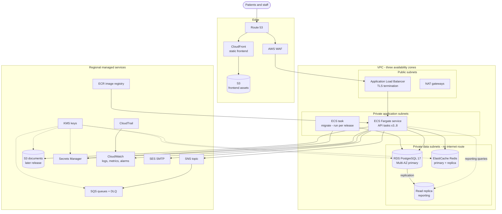

# Deployment

This document describes the reference deployment of the platform on AWS, the reasoning behind the
service choices, and the procedures for releasing, migrating, monitoring and recovering it.

> **Status.** This is a reference design. **Nothing has been deployed.** The Terraform modules and
> the production release pipeline described here are **not yet written** and are listed as remaining
> work in section 13. Production infrastructure must not be created without explicit approval.
>
> **PHI.** Before protected health information is placed in any service, a Business Associate
> Agreement must be signed with AWS, and each service must be checked against AWS's **current** list
> of HIPAA-eligible services and configured as that programme requires. Eligibility is
> service-specific and changes over time; this document does not assert the eligibility of any
> service. See [security-and-compliance.md](security-and-compliance.md).

The architecture is portable: the application is a container that needs PostgreSQL, a Redis-protocol
cache, a message broker and an SMTP endpoint. AWS is the reference, not a requirement.

For running the system on a workstation, see the README (Docker Compose for PostgreSQL, Redis,
RabbitMQ and a local mail catcher).

---

## 0. Building and running the Python backend

**Container image** (multi-stage `Dockerfile`: uv resolves the locked dependencies in a build stage; the
runtime stage is `python:3.14-slim` with only the virtual environment and a non-root user, UID 10001):

```bash
docker build -t healthcare-api:local .
# One-off migration task as the schema owner
docker run --rm -e ConnectionStrings__Migrations="Host=db;Database=healthcare;Username=healthcare_migrator;Password=..."   healthcare-api:local migrate
# API: Uvicorn with HEALTHCARE_WORKERS worker processes on port 8080
docker run -p 8080:8080 -e ASPNETCORE_ENVIRONMENT=Production -e HEALTHCARE_WORKERS=4   -e ConnectionStrings__Database="Host=db;Database=healthcare;Username=healthcare_app;Password=...;Maximum Pool Size=10"   -e ConnectionStrings__Redis="redis:6379" -e Auth__SigningKeyPem="$(cat signing.pem)"   -e Auth__FieldEncryptionKey="..." healthcare-api:local
```

**Without containers** (Linux or Windows; the commands in the README were verified on Windows):

```bash
uv sync --frozen --no-dev            # creates .venv with Python 3.14 and the locked dependencies
uv run python -m healthcare migrate  # ConnectionStrings__Migrations set
uv run python -m healthcare          # serve; HEALTHCARE_WORKERS processes, port from ASPNETCORE_HTTP_PORTS/PORT (8080)
```

Sizing: one worker process per vCPU of the task is the starting point (Python executes on one core per
process). The connection pool (`Maximum Pool Size`) applies per worker, so
`instances × workers × pool size` must stay below the database's `max_connections` budget in
[capacity-model.md](capacity-model.md). Production settings are the same environment variables as the
reference (`ConnectionStrings__*`, `Auth__*`, `Email__*`, `Messaging__*`, `Workers__*`,
`RateLimiting__*`, `Cors__AllowedOrigins__N`, `ForwardedHeaders__Enabled`), plus `HEALTHCARE_WORKERS`.

---

## 1. Deployable units

| Unit | Description |
|---|---|
| API container | The FastAPI application (`python -m healthcare`), served by Uvicorn with `HEALTHCARE_WORKERS` worker processes. Stateless. Every worker also hosts the background workers (outbox dispatcher, reminder scheduler, maintenance, email dispatch); `SKIP LOCKED` keeps them safe. |
| Migration task | The **same image** started with the `migrate` argument (`python -m healthcare migrate`). Applies the Alembic migrations (reviewed SQL) and exits. Uses the `healthcare_migrator` database role. |

The API connects to PostgreSQL as `healthcare_app`, a role that does not own the tables and cannot
bypass row-level security. Only the migration task receives the owner credential.

Background workers run inside every API instance. They are safe to run concurrently because work is
claimed with `FOR UPDATE SKIP LOCKED`. If worker load ever needs to scale independently, the same
image can be started as a second service with HTTP traffic disabled; this is not needed at the
first scale milestone.

---

## 2. Reference architecture



---

## 3. Service evaluation

### 3.1 Compute: ECS on Fargate versus EKS

| Criterion | ECS on Fargate | EKS |
|---|---|---|
| Operational effort | Low. No cluster or node management, no control-plane upgrades | High. Cluster version upgrades, node groups or Karpenter, add-ons, ingress controllers, admission policies |
| Fit for this workload | One stateless service plus a run-to-completion migration task | Designed for many services with complex scheduling needs |
| Team skills required | AWS fundamentals | Kubernetes expertise on the team and on call |
| Fixed cost | None beyond tasks | Control-plane fee per cluster per environment, plus system workloads |
| Scaling | Target tracking on CPU or requests per target | Horizontal Pod Autoscaler plus node autoscaling |
| Deployments | Rolling or blue/green with CodeDeploy | Rolling, with a wide ecosystem of tools |
| Portability | AWS-specific task definitions; the container itself is portable | Manifests portable across clouds |
| Ecosystem | Smaller | Service mesh, operators, GitOps tooling |
| Security patching | AWS patches the host | Operator patches nodes (unless Fargate profiles are used) |

**Recommendation: ECS on Fargate.**

The platform is a modular monolith: one container image, one service, one scheduled task. Kubernetes
would add a control plane to operate, upgrade and secure without solving a problem the system has.
For a small engineering team handling regulated data, a smaller operational surface is also a
smaller attack surface.

Trade-offs accepted:

- Task definitions and service configuration are AWS-specific. The cost of moving is limited
  because the application depends only on a container runtime and standard protocols.
- Less control over the host (no daemon sets, no privileged sidecars). Not required today.
- Per-vCPU cost is higher than well-packed EC2 nodes. At three to eight small tasks the difference is
  minor compared with the operational saving.

Revisit the decision if the system is split into many independently deployed services, if workloads
appear that Fargate cannot run, or if a multi-cloud requirement emerges.

### 3.2 Other services

| Service | Role | Decision and reasoning |
|---|---|---|
| **Application Load Balancer** | TLS termination, health-checked routing to tasks across zones | Use. Health check on `/health/ready`; deregistration delay aligned with graceful shutdown; TLS 1.2+ policy; access logs to S3 |
| **RDS for PostgreSQL** | Primary data store | Use, PostgreSQL 17, **Multi-AZ** for automatic failover, storage encrypted with a customer-managed KMS key, `rds.force_ssl`, automated backups with point-in-time recovery, deletion protection. One **read replica** for reporting from Release 4 onward. Aurora PostgreSQL is an alternative when replica count or failover time becomes the constraint; standard RDS is simpler and sufficient at the first milestone |
| **ElastiCache (Redis)** | Distributed cache for session status and access lookups | Use, one primary and one replica in different zones, in-transit and at-rest encryption, authentication enabled. The cache is an optimization; the application falls back to PostgreSQL if it is unavailable |
| **S3** | Frontend assets; ALB and audit log archives; patient documents (Release 3) | Use. Block public access, default KMS encryption, versioning, lifecycle rules, bucket policies that deny non-TLS access |
| **Messaging** | Publication of domain events from the transactional outbox | See section 3.3 |
| **CloudFront** | CDN for the React frontend | Use for static assets only. API traffic goes to the ALB directly so that no API responses are cached at the edge |
| **AWS KMS** | Key management | Use. Separate customer-managed keys per environment and per data class (database, object storage, secrets); rotation enabled; key policies restrict use to the owning services |
| **Secrets Manager** | Database credentials, JWT signing key, field-encryption key, SMTP credentials | Use. Injected into tasks as secrets; rotation for database credentials. Parameter Store holds non-secret configuration |
| **CloudWatch** | Logs, metrics, alarms, dashboards | Use. The application writes structured JSON logs to stdout; OpenTelemetry traces and metrics are exported over OTLP to a collector sidecar (AWS Distro for OpenTelemetry) and on to CloudWatch and X-Ray, or to another backend |
| **CloudTrail** | Record of AWS API activity | Use. Organization trail, all regions, log-file validation, delivered to a dedicated log-archive account |
| **AWS WAF** | Request filtering in front of the ALB | Use. Managed rule groups (common, known bad inputs, SQL injection), rate-based rules per address, stricter limits on authentication paths |
| **SES** | Outbound email through the SMTP interface | Use for transactional email once the account is out of the sandbox and covered by the BAA. The application's SMTP sender needs no code change |
| **Route 53, ACM** | DNS and certificates | Use |
| **ECR** | Container registry | Use. Immutable tags, scan on push, lifecycle policy |

### 3.3 Messaging: SQS/SNS, RabbitMQ or Kafka

The application writes events to an outbox table in the same transaction as the business change. A
dispatcher publishes them through a pluggable publisher interface, so the broker is a deployment
choice.

| Criterion | SQS + SNS | RabbitMQ (Amazon MQ) | Kafka (MSK) |
|---|---|---|---|
| Operations | Fully managed, no brokers | Managed brokers, but sizing, patch windows and failover to plan | Clusters to size, partition and monitor |
| Throughput needed (≈ 3 events/s average, ≈ 15/s peak) | Far exceeds | Far exceeds | Far exceeds; unjustified at this volume |
| Delivery model | Fan-out with SNS, per-consumer SQS queues, dead-letter queues | Flexible routing (topic exchanges), per-message acknowledgement | Ordered, replayable log |
| Ordering | FIFO queues per message group if needed | Per queue | Per partition |
| Replay | No (consumers can rebuild from the outbox table) | No | Yes |
| Cost at low volume | Pay per request; negligible | Always-on brokers | Always-on brokers, the most expensive option |
| Local development | Emulator required | Runs in Docker Compose | Heavier local footprint |

**Decision.**

- **Local development and the reference implementation use RabbitMQ**, which runs easily in Docker
  Compose and exercises the same publish path.
- **The AWS reference deployment uses SNS with SQS queues and dead-letter queues**: no brokers to
  operate, encryption with KMS, and more than enough capacity. This requires an SNS publisher
  implementation behind the existing publisher interface, which is **not yet written**.
- **Amazon MQ for RabbitMQ** is the alternative that needs no new code, at the cost of operating
  brokers.
- **Kafka is not adopted.** Event replay and very high throughput are not current requirements. It
  becomes relevant if an event-streaming or analytics pipeline is introduced.

Events carry identifiers only, never PHI, whichever broker is used.

---

## 4. Environments

| Aspect | Development | Staging | Production |
|---|---|---|---|
| AWS account | Separate | Separate | Separate, restricted access |
| Purpose | Integration of work in progress | Release candidate verification, performance tests | Live service |
| Data | Synthetic | Synthetic, production-like volume | Real data only after the compliance prerequisites are met |
| API tasks | 1 | 2 | 3–8, autoscaled |
| Database | Single-AZ, small | Multi-AZ, production instance class for performance runs | Multi-AZ, read replica when reporting is released |
| Redis | Single node | Primary + replica | Primary + replica |
| Deployment | Automatic on merge to main | Automatic on release tag | Manual approval after staging verification |
| Access | Engineers | Engineers | Least privilege, break-glass with audit |

Rules:

- Separate accounts under AWS Organizations, with service control policies that prevent disabling
  CloudTrail, creating public buckets or using unapproved regions.
- No shared secrets, keys or databases between environments.
- Production data is never copied to other environments.
- All environments are created from the same Terraform modules with different variables, so staging
  matches production in shape.

---

## 5. Network design

- One VPC per environment across three availability zones.
- **Public subnets:** load balancer and NAT gateways only.
- **Private application subnets:** ECS tasks. No public IP addresses. Outbound traffic through NAT
  gateways; AWS service traffic through VPC endpoints (ECR, S3, Secrets Manager, KMS, CloudWatch
  Logs, SQS, SNS) so it does not traverse the internet.
- **Private data subnets:** RDS and ElastiCache. No route to the internet.
- Security groups allow only the required paths:

| From | To | Port |
|---|---|---|
| Internet (through WAF) | ALB | 443 |
| ALB | API tasks | Application port |
| API tasks, migration task | RDS | 5432 |
| API tasks | ElastiCache | 6379 (TLS) |
| API tasks | VPC endpoints, NAT | 443 |

- No SSH access to anything. Administrative database access goes through a controlled, logged path
  (for example Systems Manager Session Manager port forwarding with short-lived credentials).
- VPC Flow Logs enabled and retained.

---

## 6. Configuration and secrets

The application is configured through environment variables; `.env.example` in the repository lists
them with placeholder values.

| Category | Source in AWS |
|---|---|
| Database connection strings (application role; migrator role for the migration task only) | Secrets Manager |
| JWT signing key (PEM), field-encryption key | Secrets Manager |
| Redis, broker and SMTP credentials | Secrets Manager |
| Non-secret settings (allowed origins, token lifetimes, feature settings, OTLP endpoint) | Task definition or Parameter Store |

The task execution role may read only its own environment's secrets. The application refuses to
start outside Development and Testing when the token signing key or the field-encryption key is
missing.

Settings that must be set for an AWS deployment:

| Setting | Value | Why |
|---|---|---|
| `ASPNETCORE_ENVIRONMENT` | `Production` (or `Staging`) | Enables HSTS and HTTPS redirection and requires real keys |
| `ForwardedHeaders__Enabled` | `true` | Behind the ALB, so client addresses (rate limiting, audit) and the HTTPS scheme are taken from `X-Forwarded-*`. Only safe when tasks accept traffic exclusively from the ALB |
| `ConnectionStrings__Redis` | ElastiCache endpoint with TLS | Required with more than one task: session and access cache invalidation must be shared |
| `ConnectionStrings__Database` | Includes `Maximum Pool Size` and `SSL Mode=VerifyFull` | Connection budget and transport security |
| `Email__Provider`, `Email__SmtpUseStartTls` | `Smtp`, `true` | SES SMTP interface |
| `Messaging__Provider` | `RabbitMq` (Amazon MQ) until the SNS publisher exists | Event publication |
| `Cors__AllowedOrigins__0` | The frontend origin | Browser access |
| `OTEL_EXPORTER_OTLP_ENDPOINT` | Collector sidecar endpoint | Traces and metrics |

Rate limits are kept in each task's memory (600 requests per minute per user, 20 per minute per
address on authentication endpoints), so the effective limit grows with the task count; WAF
rate-based rules provide the global limit.

---

## 7. CI/CD pipeline

The repository's CI workflow (`ci/github-actions/ci.yml`) covers stages 1–3, the dependency audit
of stage 4 (secret scanning and static analysis are not yet configured) and the image build and scan
(stages 5–6, without SBOM generation): install the locked dependencies with uv, `ruff check` and
`ruff format --check`, `mypy --strict` for `src` and `tests`, a `pip-audit` of the locked runtime
dependencies, all tests against a PostgreSQL service container (the integration tests migrate a fresh
database, so a broken migration fails the run), and a Trivy scan of the image. It has not yet been run on a hosted runner. Stages 7–13 (push, migrate, deploy,
approval) are the target release pipeline and are **not yet written**.

| Stage | Actions | Gate |
|---|---|---|
| 1. Build | Install locked dependencies (`uv sync --frozen`), lint and format check (ruff), strict type check (mypy) | Must pass |
| 2. Unit tests | Run unit tests | Must pass |
| 3. Integration and API tests | PostgreSQL service container (`HEALTHCARE_TEST_POSTGRES`) or Testcontainers; run integration, API, security, tenant-isolation, booking-concurrency and contract tests | Must pass |
| 4. Static checks | Dependency vulnerability audit, secret scanning, static analysis | No high or critical findings |
| 5. Image build | Build the container image, tag with the commit SHA, generate an SBOM | — |
| 6. Image scan | Scan the image (ECR scanning or Trivy) | No high or critical vulnerabilities without a recorded exception |
| 7. Push | Push to ECR with an immutable tag; sign the image | — |
| 8. Migrate (staging) | Run the migration task with the new image | Task exits successfully |
| 9. Deploy (staging) | Rolling deployment; smoke tests against `/health/ready` and key API flows | Must pass |
| 10. Verification | Automated API suite; performance tests for releases that touch hot paths | Must pass |
| 11. Approval | Manual approval by an authorized releaser | Required for production |
| 12. Migrate (production) | Snapshot check, then the migration task | Task exits successfully |
| 13. Deploy (production) | Rolling or blue/green deployment with automatic rollback on failed health checks or alarms | Health checks and alarms |

Pipeline credentials use short-lived federated roles (OIDC), not long-lived access keys. The
pipeline never has access to production data.

---

## 8. Database migrations

### 8.1 One-time bootstrap per environment

A database administrator runs `deploy/sql/create-roles.sql` once per database server, as the RDS
master user:

```bash
psql "host=<rds-endpoint> dbname=postgres user=<master> sslmode=require" \
     -v migrator_password='<from Secrets Manager>' -v app_password='<from Secrets Manager>' \
     -f deploy/sql/create-roles.sql
```

1. The script creates `healthcare_migrator` (owner of the `healthcare` database and its schemas) and
   `healthcare_app` (login, no `BYPASSRLS`, no ownership), creates the database, installs
   `btree_gist` and revokes `CREATE` on `public`.
2. Both credentials are stored in Secrets Manager before the script runs.

The master user is not used by the application or by routine migrations.

### 8.2 Release procedure

1. The pipeline runs the migration task: `python -m healthcare migrate` with the migrator
   connection string.
2. Migrations create or alter tables, constraints (including the appointment exclusion constraint),
   row-level security policies and grants to `healthcare_app`.
3. The task exits with a non-zero code on failure, which stops the pipeline before any new
   application task starts.
4. The application deployment begins only after the migration succeeds.

### 8.3 Rules for safe migrations

- **Backward compatible first (expand and contract).** During a rolling deployment old and new
  application versions run together, so a migration must not break the previous version. Add columns
  as nullable or with defaults; remove or rename only in a later release after no running version
  uses the old shape.
- **No long locks.** Create indexes concurrently on large tables; add constraints as `NOT VALID` and
  validate separately; set a lock timeout so a blocked migration fails fast instead of queueing
  behind traffic.
- **Every new tenant-owned table** gets `organization_id`, row-level security enabled and forced, a
  policy, and explicit grants. The isolation tests exercise the existing tables; an automated
  catalogue check that no tenant-owned table lacks a policy is recommended and not yet written.
- **Rollback.** Prefer a forward fix. For destructive changes, take a manual snapshot first and
  record the restore point. Application rollback is safe because migrations are backward compatible.
- **Review.** The generated SQL script for each migration is reviewed in the pull request.

---

## 9. Health checks and graceful shutdown

| Endpoint | Meaning | Used by |
|---|---|---|
| `/health/live` | The process is running. No dependency checks | Container health check (restart if failing) |
| `/health/ready` | PostgreSQL is reachable (503 when not). Redis is checked too but reported as *degraded* (still 200) because the application falls back to the database. The broker is not checked; unpublished events wait in the outbox | Load balancer target health (stop routing if failing) |

Shutdown sequence when ECS stops a task (deployment, scale-in or host maintenance):

1. ECS deregisters the task from the target group; the load balancer stops sending new requests and
   waits for the deregistration delay.
2. ECS sends `SIGTERM`. Uvicorn stops accepting new connections in every worker process and lets
   in-flight requests finish within the configured shutdown timeout (`HostOptions__ShutdownTimeoutSeconds`,
   passed to Uvicorn as `timeout_graceful_shutdown`).
3. The FastAPI lifespan cancels the background tasks; a batch interrupted mid-transaction is rolled back
   and its `SKIP LOCKED` row locks are released. Unpublished
   outbox rows and due reminders remain in the database and are picked up by another instance, so
   no work is lost.
4. The process exits. If it has not exited when the task `stopTimeout` elapses, ECS sends `SIGKILL`.

Settings to align: deregistration delay (30 s) ≤ application shutdown timeout (30 s) < task
`stopTimeout` (60 s). Deployments keep at least 100 % of the desired healthy tasks in service
(minimum healthy 100 %, maximum 200 %).

---

## 10. Monitoring and alerting

### 10.1 Signals

| Signal | Source | Content |
|---|---|---|
| Logs | JSON lines on stdout (standard-library logging with a JSON formatter) → CloudWatch Logs | Request summaries with route template, status, duration, trace identifier, user and organization identifiers. No PHI |
| Traces | OpenTelemetry server spans per request → OTLP/HTTP collector | Request spans with W3C trace context; no bodies or parameters recorded |
| Metrics | Container CPU/memory and the request log; RDS, ElastiCache, ALB and SQS metrics | Rates, latencies, saturation |
| Audit | `platform.audit_events` | Access to PHI and security-relevant actions |
| AWS activity | CloudTrail | Infrastructure changes and key usage |

### 10.2 Alerts

Thresholds are starting points to tune against observed baselines.

| Alert | Condition | Severity |
|---|---|---|
| API availability | 5xx rate above 1 % for 5 minutes | Page |
| Read latency | p95 above 300 ms for 10 minutes | Ticket; page if above 1 s |
| Booking latency | p95 above 500 ms for 10 minutes | Ticket; page if above 2 s |
| Unhealthy targets | Healthy task count below desired for 3 minutes | Page |
| Database CPU | Above 80 % for 10 minutes | Ticket |
| Database connections | Above 80 % of `max_connections` | Page |
| Database storage | Free storage below 20 % | Ticket |
| Replication lag | Replica lag above 30 s | Ticket |
| Outbox backlog | Oldest unpublished event older than 5 minutes | Page |
| Dead-letter queue | Any message in a dead-letter queue | Ticket |
| Reminder delay | Due reminders unprocessed for 10 minutes | Ticket |
| Cache | Redis memory above 80 % or evictions occurring | Ticket |
| Authentication anomalies | Spike in failed sign-ins or lockouts | Security review |
| Authorization failures | Spike in 403 responses for one account | Security review |
| WAF | Sustained block rate increase | Security review |
| Certificates | Expiry within 21 days | Ticket |

Dashboards cover the four golden signals per endpoint group, database health, queue depth and
background worker throughput. The 99.9 % availability target is tracked as a monthly error budget.

---

## 11. Backup and restore

### 11.1 Backup configuration

| Item | Configuration |
|---|---|
| Automated backups | Enabled, 35-day retention, point-in-time recovery |
| Snapshots | Monthly manual snapshot retained 12 months; snapshot before every production migration that changes existing data |
| Cross-region | Automated backup replication or snapshot copy to a second region, encrypted with a key in that region |
| Encryption | All backups encrypted with the database KMS key |
| Object storage | Versioning and cross-region replication for document buckets (Release 3) |
| Redis | Not backed up. It holds only reconstructible cache entries |
| Configuration | Terraform state in a versioned, encrypted bucket with state locking |

### 11.2 Restore procedure (point in time)

1. Declare an incident and decide the target recovery time with the incident lead.
2. Stop writes: scale the API service to zero or enable maintenance mode at the load balancer.
3. Restore the database to a **new** instance at the chosen time (`restore-db-instance-to-point-in-time`),
   in the data subnets, with the same parameter group, KMS key and security groups.
4. Verify the restored instance: migration history table matches the deployed version; row counts
   and latest timestamps in key tables; row-level security is enabled on tenant tables; the
   application role can connect and cannot bypass policies.
5. Point the application at the restored instance by updating the connection secret, then start the
   API service and confirm `/health/ready`.
6. Run smoke tests: sign in, list appointments, book and cancel a test appointment in a test
   organization.
7. Re-create the read replica and confirm backups are enabled on the new instance.
8. Keep the old instance, isolated, until the post-incident review is complete; then remove it.
9. Record the actual recovery point and recovery time.

Events written to the outbox before the recovery point but already published may be published
again; consumers must be idempotent.

### 11.3 Regional recovery

Rebuild the environment in the second region from Terraform, restore the database from the replicated
backup, restore secrets, deploy the last released image and switch DNS. This path is slower and is
rehearsed at least annually.

### 11.4 Restore testing

Restore the latest production backup into an isolated account at least quarterly, run the
verification steps, and record the result and duration. Objectives (RPO ≤ 5 minutes, RTO ≤ 1 hour
for a zone failure) are targets until they have been demonstrated.

---

## 12. Security configuration checklist

- [ ] BAA signed with AWS; every service in use checked against the current HIPAA-eligible list
- [ ] TLS 1.2+ on the load balancer; HTTP redirected to HTTPS; HSTS enabled by the application
- [ ] RDS: encryption with a customer-managed key, `rds.force_ssl=1`, not publicly accessible,
      deletion protection, enhanced monitoring, PostgreSQL connection and DDL logging
- [ ] ElastiCache: encryption in transit and at rest, authentication, private subnets
- [ ] S3: block public access, default encryption, TLS-only bucket policy, versioning, access logs
- [ ] SQS/SNS: KMS encryption, least-privilege queue and topic policies, dead-letter queues
- [ ] IAM: least-privilege task roles, no long-lived access keys, MFA for human access
- [ ] CloudTrail organization trail with log-file validation, delivered to a log-archive account
- [ ] GuardDuty, Security Hub and AWS Config enabled
- [ ] WAF managed rules and rate limits on the load balancer
- [ ] VPC Flow Logs enabled
- [ ] Container images scanned; base images updated regularly; tasks run as a non-root user with a
      read-only root file system
- [ ] Log retention set; logs verified to contain no PHI

---

## 13. Remaining work

| Item | Status |
|---|---|
| Terraform modules (network, ECS service, RDS, ElastiCache, messaging, WAF, monitoring) and per-environment configurations | Not written |
| Production release pipeline (stages 7–13 in section 7) | Not written |
| Running the CI workflow on a hosted runner | Not yet performed |
| SNS/SQS event publisher behind the existing publisher interface | Not written; RabbitMQ publisher exists |
| OpenTelemetry collector configuration for AWS | Not written |
| Alarm and dashboard definitions | Not written |
| Runbooks for failover, restore and key rotation | Outlined here; not rehearsed |
| Load and failover testing in a deployed environment | Not performed |
| Any deployment to AWS | Not performed |
